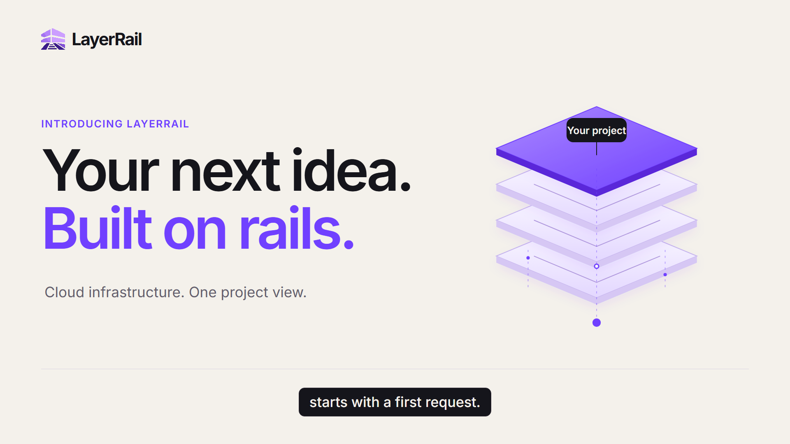
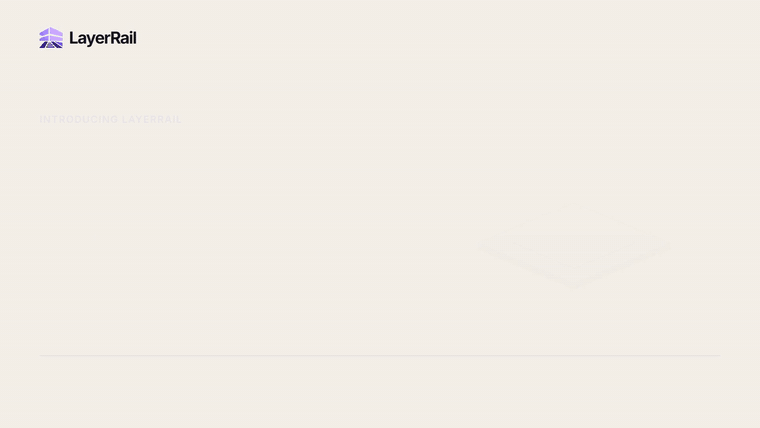
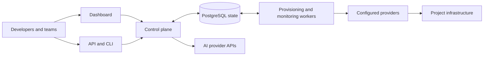

<p align="center">
  
</p>

<h1 align="center">LayerRail</h1>

<p align="center"><strong>One project. Your infrastructure. A clearer way to build.</strong></p>

<p align="center">
  <a href="https://console.layerrail.com">Open the dashboard</a> ·
  <a href="https://docs.layerrail.com">Documentation</a> ·
  <a href="openapi/openapi.yml">API reference</a> ·
  <a href="docs/getting-started.md">Run locally</a>
</p>

LayerRail is an open source cloud control plane for developers and teams. Manage
virtual machines, networking, PostgreSQL, Kubernetes, GitHub runners, and AI
inference through a project-centered dashboard and API, with access controls,
resource state, and usage close at hand.

This repository contains the **API, dashboard, and provisioning workers** behind
LayerRail. Use the hosted platform to build, or explore the code and run the
control plane yourself.

## See LayerRail in motion

[](docs/launch.md)

**[Watch the launch film and open the interactive preview →](docs/launch.md)**

An introduction to the API, dashboard, and project workflow. The preview uses an
illustrative workspace; it contains no customer data.

## From an API request to a running project

| Build with | What you can do |
| --- | --- |
| **Compute** | Create Linux virtual machines and inspect their state, sizing, networking, and backups. |
| **Networking** | Organize private subnets, control traffic with firewalls, and route requests through load balancers. |
| **PostgreSQL** | Manage databases, backup and restore workflows, configuration, and monitoring. |
| **Kubernetes** | Manage clusters, node pools, kubeconfigs, resizing, and upgrades. |
| **GitHub Actions** | Connect repositories to managed runners from the same project. |
| **AI inference** | Explore models in the playground and call supported chat, Responses, and embedding APIs. |
| **Project operations** | Manage team access, personal access tokens, audit logs, usage, credits, and invoices. |

Service availability depends on the deployment's enabled features, configured
providers, and model catalog. The hosted dashboard shows the options available
to your project.

### Automate through the API

Create a **personal access token** in your project's dashboard, copy the project
ID, and list its virtual machines:

```sh
export LR_TOKEN="pat-YOUR_PERSONAL_ACCESS_TOKEN"
export PROJECT_ID="YOUR_PROJECT_ID"

curl --fail-with-body \
  "https://api.console.layerrail.com/project/${PROJECT_ID}/vm" \
  -H "Authorization: Bearer ${LR_TOKEN}"
```

Requests respect your account and token permissions. The
[OpenAPI specification](openapi/openapi.yml) documents infrastructure endpoints,
request bodies, and pagination. For terminal workflows, see the [`lr` CLI](cli/README.md).

### Bring AI into the same workflow

Create a separate **inference API key** in your project, then make a supported
Responses request:

```sh
export LAYERRAIL_AI_KEY="YOUR_INFERENCE_API_KEY"

curl --fail-with-body https://api.console.layerrail.com/v1/responses \
  -H "Authorization: Bearer ${LAYERRAIL_AI_KEY}" \
  -H "Content-Type: application/json" \
  -d '{
    "model": "gpt-6.1-sol",
    "input": "Explain what a cloud control plane does in one paragraph.",
    "reasoning": {"effort": "low"},
    "max_output_tokens": 1024,
    "store": false
  }'
```

AI requests require an available model and verified project billing. Usage is
paid; model prices and supported request formats are shown in the catalog. See
the [GPT-6 API notes](docs/gpt-6-catalog.md) and [usage billing guide](docs/paid-inference-billing.md).

## Try the dashboard locally

With Git, Docker Compose, and a POSIX shell installed:

```sh
git clone https://github.com/layerrail/layerrail.git
cd layerrail

./demo/generate_env
docker compose -f demo/docker-compose.yml up --build
```

Open **[localhost:3000](http://localhost:3000)**. The demo starts a PostgreSQL
database, applies migrations, and runs the web service and background workers.
On Windows, run these commands from WSL or another POSIX shell.

The demo provides a local control plane. Configure provider credentials and
service prerequisites before provisioning cloud resources. Follow the
[getting started guide](docs/getting-started.md) for account setup, API access,
and deployment configuration.

## How it fits together



The Ruby control plane uses **Roda**, **Sequel**, and **Rodauth**. The dashboard
uses server-rendered views with Tailwind CSS and a React-based AI playground.
Background workers provision and reconcile infrastructure; PostgreSQL stores
control-plane state.

| Explore the source | Start here |
| --- | --- |
| HTTP routing and API behavior | [`clover.rb`](clover.rb), [`routes/`](routes/), [`openapi/`](openapi/) |
| Dashboard and playground | [`views/`](views/), [`assets/js/playground/`](assets/js/playground/) |
| Domain models and database changes | [`model/`](model/), [`migrate/`](migrate/) |
| Provisioning and reconciliation | [`prog/`](prog/), [`rhizome/`](rhizome/) |
| Command line workflows | [`cli/`](cli/), [`cli-commands/`](cli-commands/) |
| Verification | [`spec/`](spec/) |

## Build with us

Read [CONTRIBUTING.md](CONTRIBUTING.md) before opening a pull request, and
[DEVELOPERS.md](DEVELOPERS.md) for the development environment and test suite.
We welcome focused improvements to provider integrations, reliability,
documentation, and the developer experience.

- **Bugs and feature requests:** [GitHub issues](https://github.com/layerrail/layerrail/issues)
- **Product support:** [support@layerrail.com](mailto:support@layerrail.com)
- **Security reports:** follow [SECURITY.md](SECURITY.md)

## Open source foundation

LayerRail is built on the [Ubicloud](https://github.com/ubicloud/ubicloud) open
source infrastructure foundation. This product fork retains the upstream
**[AGPL-3.0 license](LICENSE)** and attribution. Preserve the original notices
and meet the license's source-sharing requirements when modifying or operating
the software over a network.
