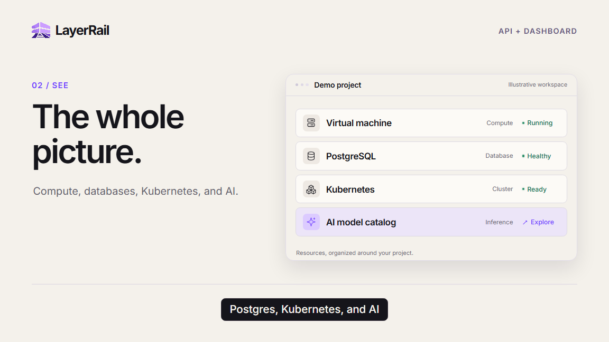

# LayerRail launch film

**[Watch the interactive launch film →](https://layerrail.github.io/layerrail/)**

A 42-second introduction to LayerRail, from a first API request to a project
view of compute, PostgreSQL, Kubernetes, AI, and usage. The film uses original
motion graphics and a clearly labeled illustrative workspace.

## Watch, explore, or share

The browser preview lets you jump to chapters, switch between widescreen and
LinkedIn layouts, and toggle captions. Its content is rendered live with
Remotion. The MP4 exports include narration, music, and captions and are ready
to upload to a social platform.

| Asset | Format |
| --- | --- |
| [Interactive preview](https://layerrail.github.io/layerrail/) | Browser player with chapter navigation |
| [Widescreen launch film](https://layerrail.github.io/layerrail/LayerRail-Launch-Widescreen.mp4) | 1920 × 1080, H.264 / AAC, 30 fps |
| [LinkedIn launch film](https://layerrail.github.io/layerrail/LayerRail-Launch-LinkedIn.mp4) | 1080 × 1350, 4:5 layout, H.264 / AAC, 30 fps |
| [Subtitles](https://layerrail.github.io/layerrail/LayerRail-Launch-Captions.srt) | Timed SRT |
| [Editable Remotion project](https://github.com/Layerrail/layerrail/releases/download/launch-film-2026-10/LayerRail-Launch-Remotion-Source.zip) | Source, brand assets, narration, and original score |

## Film chapters

| Time | Story |
| --- | --- |
| 00:00 | Your next idea. Built on rails. |
| 00:06 | Start with an API request |
| 00:13 | See the whole project |
| 00:21 | Bring services together |
| 00:28 | Understand usage |
| 00:35 | Open source at the core |

## Production notes

The dashboard cards and topology are product illustrations, rather than a
recording of a live customer workspace. Sample statuses and usage are labeled
illustrative; they do not promise availability, savings, or performance.

The soundtrack contains newly generated synthetic narration and LayerRail's
original synthesized score. The editable project includes the script, timed
captions, production notes, and checks for audio levels and video dimensions.
Main scenes and text remain editable in Remotion Studio.

GitHub displays the small animated preview in the README. Follow its link to
use the interactive controls or download the full film.
